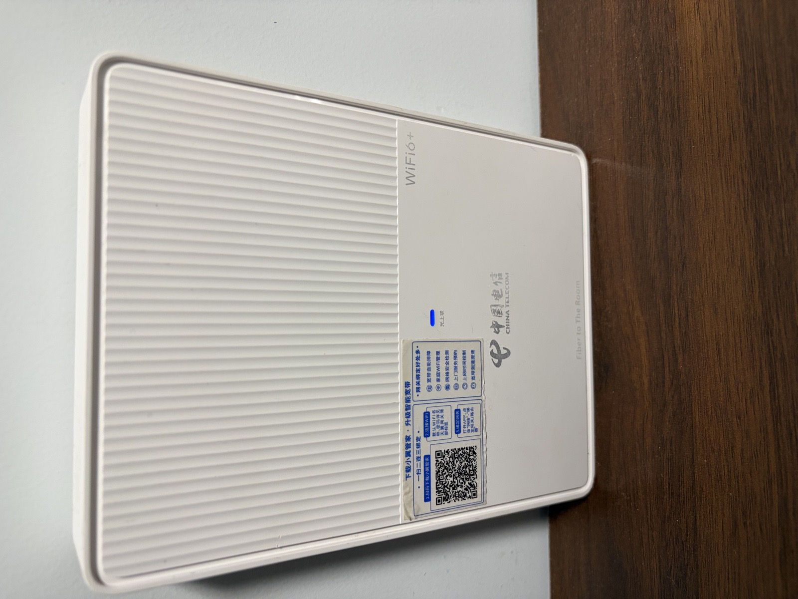
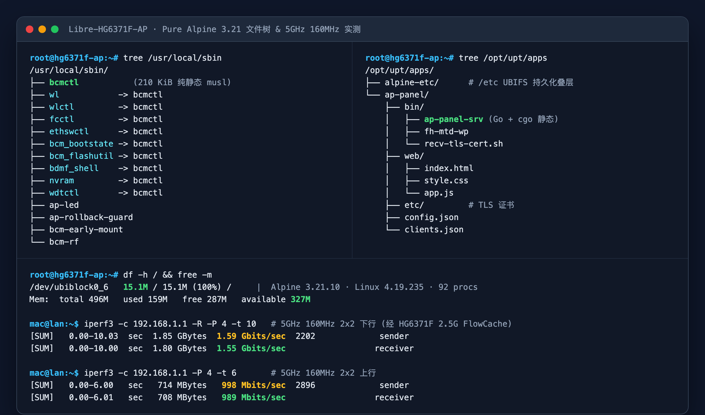
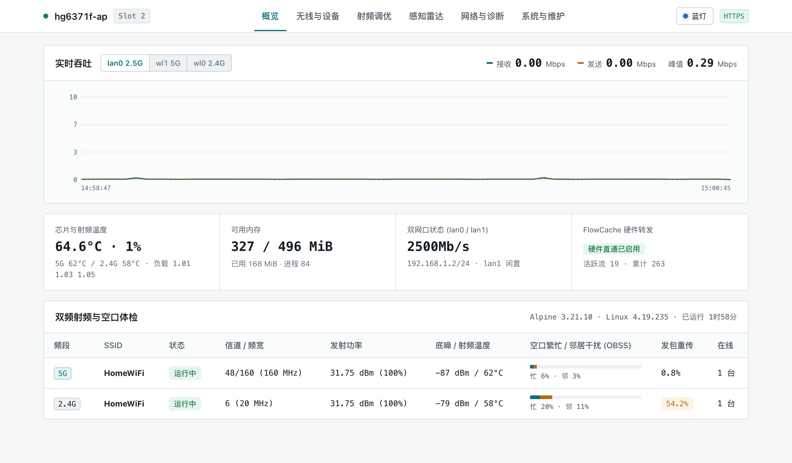
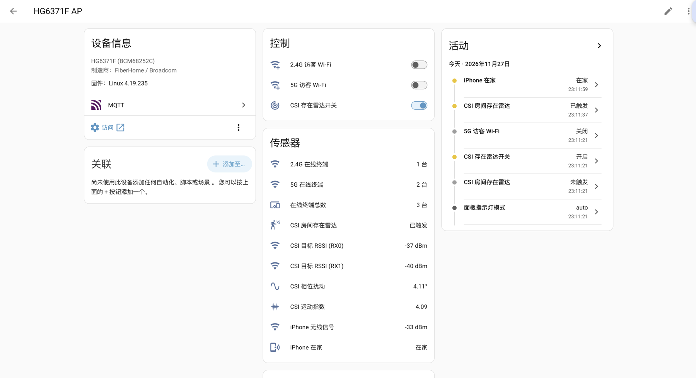

# Libre-HG6371F-AP

将闲置/二手烽火 **HG6371F**（Broadcom BCM68252C，2.5G 上联 + 160MHz Wi-Fi 6 + 512MB RAM）彻底脱壳改造为 **纯净 Alpine Linux 3.21 + 100% 开源重写博通用户态（`bcmopen`）+ 零依赖 Go 运维面板** 的纯二层 2.5G 无线 AP 方案。

配套自编开源 Linux 4.19 内核仓库见：**`libre-hg6371f-kernel`**（GPLv2）。

> **⚠️ 重要声明（刷前必读）**
>
> 1. **纯二层 AP 定位**：本方案**已彻底移除 PON 光猫、TR-069、拨号路由及全部运营商组件**，仅用于局域网纯 2.5G 无线 AP，**不可替代入户主光猫**。
> 2. **请勿盲目照搬命令，建议先用你自己的 AI Agent 摸清本机**：HG6371F 存在中国电信 / 中国移动 / 中国联通及不同出厂批次差异（Telnet 提权路径、U-Boot 验签分支、UBI 分区容量、驱动版本与 GPIO 引脚均可能不同）。本仓库仅在作者自购的中国电信实机（BCM68252C、`hwcfg=0xba`）上验证通过。
>    - 动手前务必冷备份 `factory`、`metadata1/2`、`bootfs1/2`、`rootfs1/2`；
>    - 建议把本仓库文档与本机采集的 `/proc/mtd`、`ubinfo -a`、原厂 `bootfs` 交给**你自己的 AI Agent** 逐项核对确认后再执行任何写入；
>    - 坚持**保留原厂槽作为救生艇、只刷非活动槽、先一次性试跑（ONCE + 180 秒自动回滚）再固化**。
> 3. **开源边界说明**：本仓库仅包含原创开源代码与构建脚本，**不分发任何原厂受版权保护的闭源二进制**（原厂 U-Boot 与无线/硬件加速 `.ko` 均由脚本在本地从用户自备的原厂备份镜像中提取）。本仓库仅供个人合法购入的离线硬件做技术研究与纯内网 AP 改造。

---

## 界面与实测一览

| 实机外观（GPIO 自控蓝灯） | 极简文件树与 `1.55 Gbps` 实测 |
| :---: | :---: |
|  |  |

| 面板概览（实时吞吐波形） | Home Assistant MQTT 自动发现 |
| :---: | :---: |
|  |  |

---

## 核心特性

- **100% 开源用户态（零 `/opt/bcm` 闭源工具、零 `glibc`/`ld-linux.so.3`）**：
  - [bcmopen/](bcmopen/)：纯 C99 开源重写全部 8 个博通闭源控制工具（`wl`、`fcctl`、`ethswctl`、`bcm_bootstate`、`bcm_flashutil`、`nvram`、`bdmf_shell`、`wdtctl`），编译为静态多合一 CLI（`bcmctl`）与静态库 `libbcmopen.a`；
  - Go 面板通过 `cgo` 静态链接 `libbcmopen.a`，实现**零 fork、零正则解析**直连内核 ABI。
- **极致轻量的纯净 Alpine Linux 3.21 (`armv7`, `musl + apk + OpenRC`)**：
  - SquashFS 根镜像仅 **`~15.7 MiB`**（原厂 32.1 MiB 直接腰斩），可用内存 **`~330 / 496 MiB`**，用户态仅 ~12 个进程，彻底消除运营商后台外联与 LXC 容器负担；
  - `/var` 内存 `overlay`（零闪存磨损）+ `/etc` UBIFS 持久化 `overlay`；
  - 上游 **`hostapd 2.11`**（2.4G + 5G 160MHz，802.11k/v/r 漫游，已关闭 WPS），Chrony 对时，OpenSSH 9.9p2。
- **满血 2.5G 无线性能**：
  - 博通 FlowCache L2/L3 硬件加速直通（实测卸载率 ~99.3%），160MHz 2×2 实测下行 **`1.28–1.7 Gbps`** / 上行 **`0.92–1.1 Gbps`**。
- **自研零依赖 Go 运维面板（RSS `~12 MiB`）**：
  - 6 页签零构建响应式界面（概览 / 无线与设备 / 射频调优 / 感知雷达 / 网络与诊断 / 系统与维护）；
  - 内核 21 指令 cBPF 旁路嗅探 ARP/DHCP/mDNS/LLMNR 自动识别终端 IP 与主机名；
  - 多 SSID + 802.1Q VLAN、一键智能体检调优与前后对比、24 小时零写闪存空口记录仪、Prometheus `/metrics` 导出；
  - **独立「感知雷达」页**：`wl.ko` 3 字节 CSIMON Netlink 补丁驱动 **160MHz Wi-Fi CSI 存在雷达** + `wl sta_monitor` 未关联靠近监测，内置纯 Go **MQTT 3.1.1 + Home Assistant 自动发现**（零 YAML 自动出实体）；
  - **安全 A/B Web OTA**：直接读 UBI `bcm_bootstate` 元数据展示双槽状态，强制一次性试跑 + **180 秒失联硬件看门狗自动回滚**。

---

## 目录结构

```text
bcmopen/          纯 C99 开源博通用户态控制库 (libbcmopen.a) 与多合一静态 CLI (bcmctl)
panel/
  server/         Go 管理面板后端（cgo 静态链接 libbcmopen.a，支持 MQTT/HA、CSI 雷达、OTA）
  web/            原生 HTML/CSS/JS 前端 SPA（零构建，移动端适配）
firmware/
  alpine/         纯净 Alpine Linux 3.21 armv7 根文件系统构建链与 OpenRC 服务
  rootfs-overlay/ 阶段一原厂精简方案叠加层（保留参考）
  fh-mtd-wp.go    mtd2 板级写保护开关工具（仅原厂内核下需要）
  flash-ab.sh     AP 端非活动槽 A/B 刷写脚本
  deploy-rootfs.py 一键端到端校验 / 刷非活动槽 / 一次性重启验收 / 固化脚本
  build-gzip-fit.py bootfs FIT（LZO → gzip）重打包脚本
  emu-gunzip.py   Unicorn U-Boot gunzip 离线验证脚本
device/           早期/阶段一脚本（start.sh / tune.sh）
recovery/         应急 Telnet+su 执行器与看门狗脚本（凭据走环境变量）
tools/tls-sync/   主路由受限 SSH 密钥自动推送泛域名 HTTPS 证书脚本
docs/
  architecture.md             硬件拓扑、分区表、A/B 运维与串口恢复手册
  boot-chain-verification.md  启动链三层校验分析与 LZO→gzip 绕过原理
  open-userland-plan.md       bcmopen 用户态全开源替代设计文档
  rf-tuning.md                5GHz / 2.4GHz 射频调优实测与雷区
```

---

## 快速构建与运维

1. 复制 `local.mk.example` 为 `local.mk`（已 gitignore），填入你的局域网 AP 地址与构建机配置：
   ```sh
   cp local.mk.example local.mk
   ```
2. 将从自己设备冷备份的原厂 `rootfs2.bin` 放到 `backups/rootfs2.bin`（`backups/` 已 gitignore，不会入库）。
3. 常用命令（本机交叉编译 `bcmopen` 与 Go `cgo` 面板需要安装 `zig` 与 `go`）：
   ```sh
   # 静态检查（JS / Shell / Python / Go）
   make check

   # 编译开源 bcmopen (libbcmopen.a + bcmctl) 并跑主机单测
   make build-bcmopen
   make test-bcmopen

   # 交叉编译静态 Go 面板后端
   make build-server

   # 构建纯净 Alpine 根文件系统（BUILD_HOST=local 或 SSH Linux root 构建机）
   make build-alpine-rootfs

   # 校验、刷入非活动槽、一次性试跑验收并固化（支持同时刷入自编内核 BOOTFS=...）
   make deploy-rootfs IMG=build/rootfs-alpine.sqfs
   ```

---

## 许可协议

本仓库原创代码采用 [MIT License](LICENSE) 开源；配套自编 Linux 4.19 内核仓库 `libre-hg6371f-kernel` 采用 GPLv2 开源。
