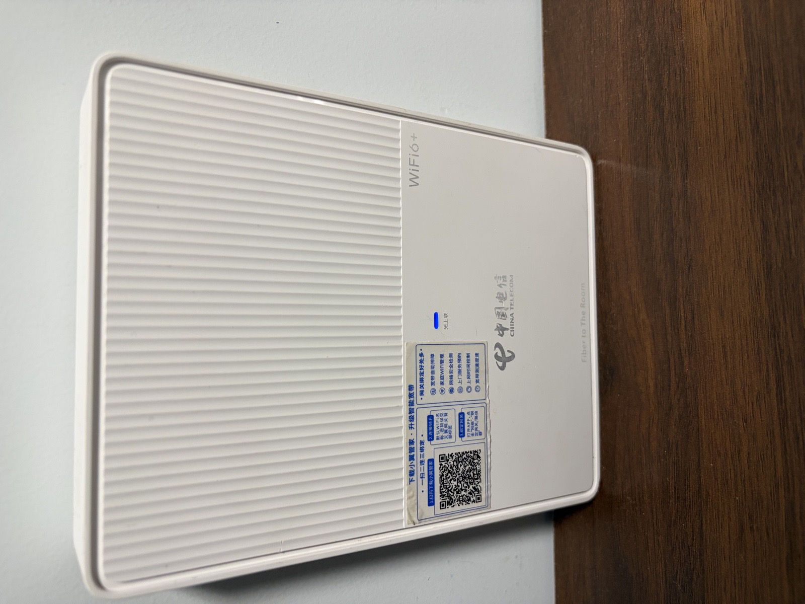
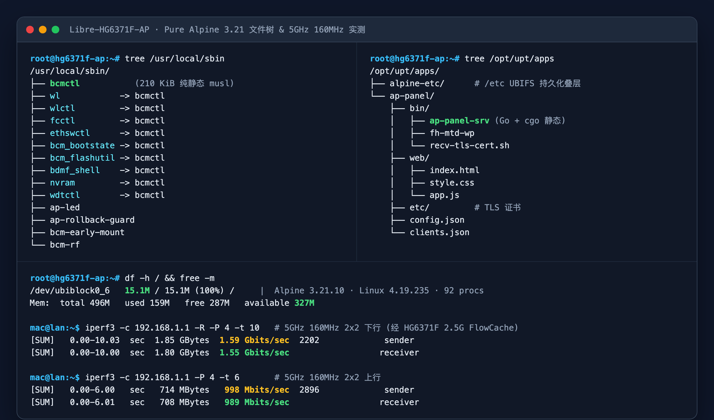
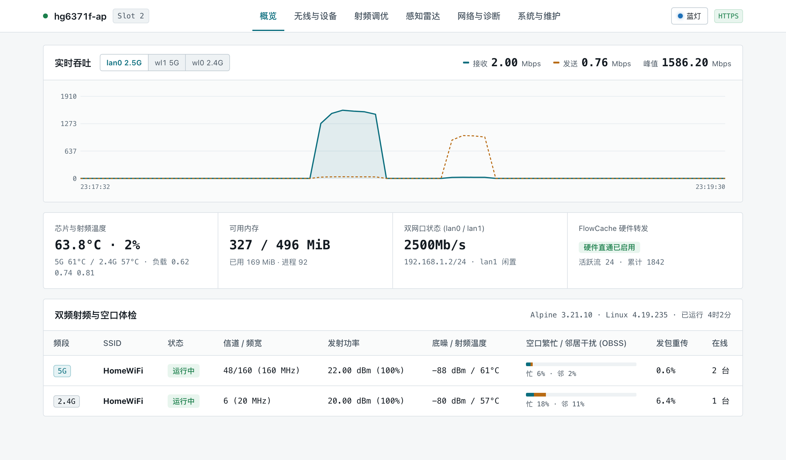
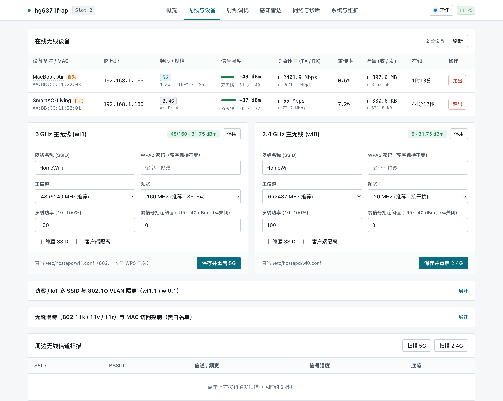
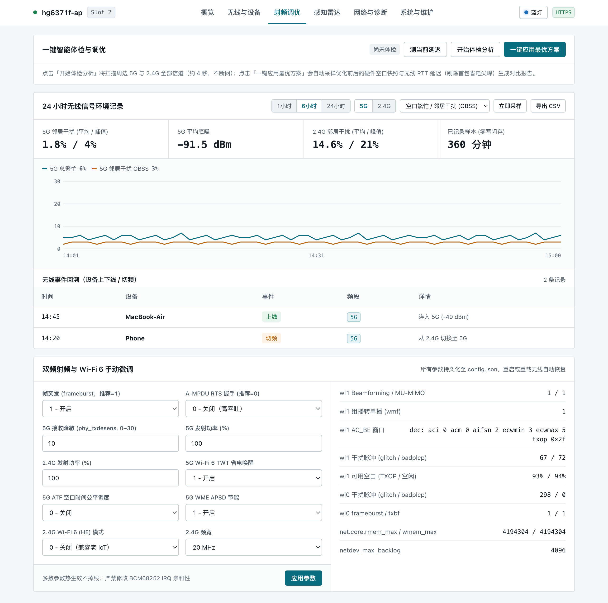
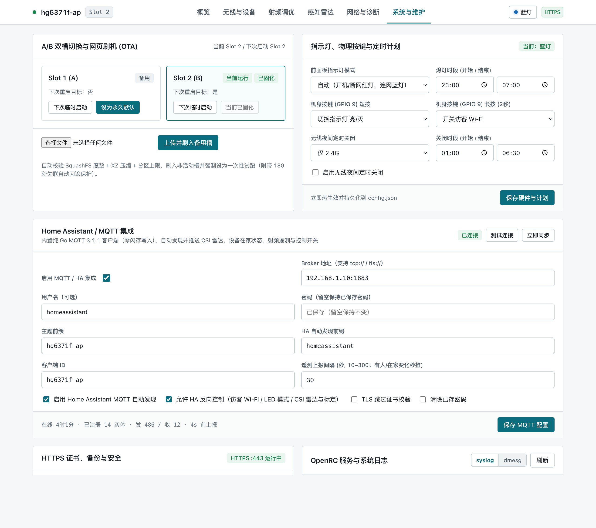
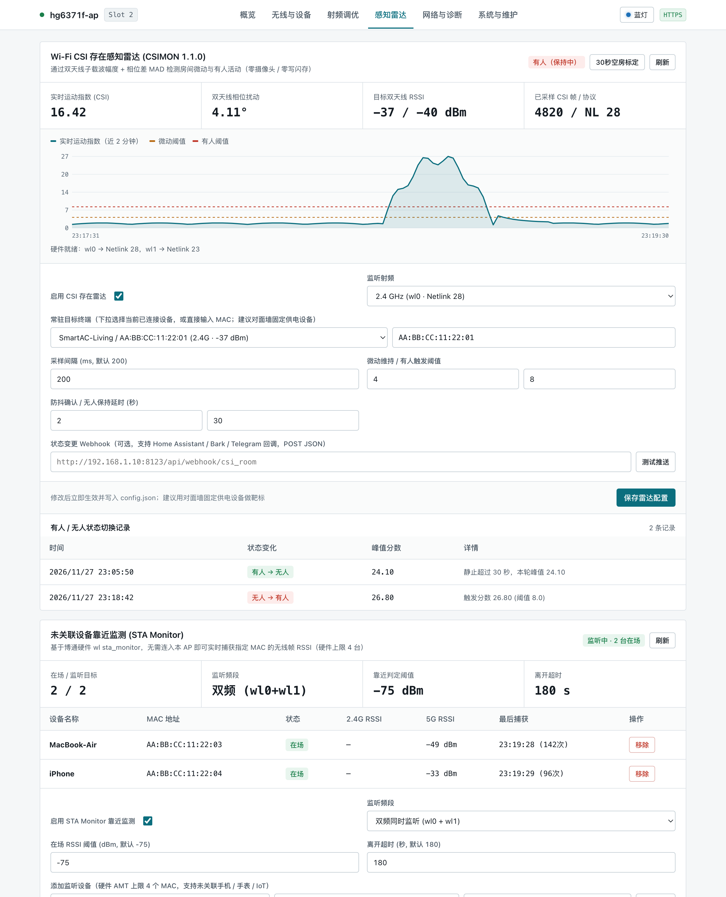
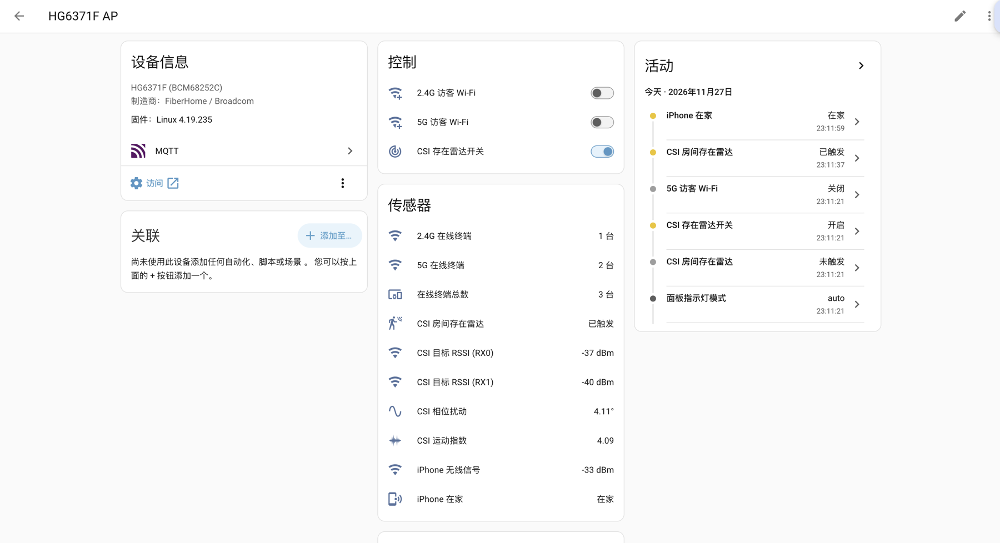

# [开源] 40元烽火 HG6371F 2.5G AP 终极改造：纯净 Alpine 3.21 + 100% 开源重写博通用户态 + 自研 Go 面板（1.55 Gbps / CSI 存在雷达 / MQTT HA 自动发现 / A/B 180s 防砖）



> 一台闲鱼 40 元收来的 FTTR 子光猫，买来当纯 2.5G 无线 AP 用。从最初拿到手摸清硬件/凭据/分区结构，到实机攻破三层启动验签、把臃肿的运营商固件连根拔起换成 **纯净 Alpine Linux 3.21 + 100% 开源重写的博通用户态（`bcmopen`）+ 上游 `hostapd 2.11` + 自研零依赖 Go 控制台（含 CSI 存在雷达与 MQTT Home Assistant 自动发现）**，全程记录在此。
>
> **⚠️ 重要声明（刷前必读）**：
> - **纯二层 2.5G AP 定位**：本方案**已彻底移除 PON 光猫、TR-069、拨号路由与全部运营商组件**，仅用于局域网纯 2.5G 无线 AP，**不可替代入户主光猫**。
> - **请勿盲目照搬命令，建议用你自己的 AI Agent 先摸清本机再动手**：HG6371F 在市面上有**中国电信 / 中国移动 / 中国联通及不同出厂批次**（本文实测为中国电信版，BCM68252C、`hwcfg=0xba`）。不同运营商或不同日期固件在 Telnet 提权路径、分区容量、U-Boot/内核/驱动偏移、GPIO 引脚上**都可能不同**。动手前务必冷备份全分区，把文档和本机 dump 交给**你自己的 AI Agent** 逐项核对确认后再写入，全程坚持**保留原厂槽作救生艇、只刷非活动槽、先一次性试跑再固化**！
> - **开源与合规边界**：本文所有 MAC、SN、密码、内网 IP、域名均已脱敏；开源仓库（`libre-hg6371f-ap`）仅包含原创开源代码与构建脚本，**不分发任何原厂闭源二进制**（原厂 U-Boot 与无线 `.ko` 均由脚本在本地从用户自备的原厂备份中提取），仅供个人合法购入的离线硬件做技术研究与纯内网 AP 改造。
> - **Roadmap 预告**：配套自编同版本 Linux `4.19.235` 开源内核（`libre-hg6371f-kernel`，GPLv2，已通过 125+ 条编译期 ABI 断言与 663/663 符号校验）目前仍在实机调试收尾中，点亮后将作为 v2.0 更新同步放出！

---

## 一、开箱摸底：硬件规格、分区表与原厂痛点

### 1.1 硬件底子
这台光猫做纯 2.5G AP 硬件其实很扎实（芯片型号与拆机图见参考 [5]，本机已通过 `/proc` 与设备信息复核）：
- **SoC**：Broadcom **BCM68252C**（双核 Cortex-A7 1.5 GHz，ARMv7l，集成 5G 2×2 160 MHz 基带，理论 2402 Mbps）
- **2.4G 射频**：独立 PCIe 芯片 **BCM6705**（Wi-Fi 6 2×2）
- **5G FEM**：RTC7676 ×2
- **有线网口**：1× 2.5G 电口（RTL8221B PHY）+ 1× 1G 电口 + GPON 光口（不插光纤时 PON RX 报 `-40 dBm` 属正常）
- **内存 / 闪存**：512 MB DDR（K4A4G165WF）+ 256 MB SPI NAND（W25N02KV，支持 A/B 双槽切换）
- **内核基线**：Linux `4.19.235`，U-Boot `2019.07`（Broadcom TPL）

### 1.2 256 MB NAND 分区表与挂载结构

```text
mtd0 spi1.0      256M
mtd1 loader        2M   ← SPL + TPL，动了就真砖，严禁写入
mtd2 image       164M   └ ubi0: metadata1/2(static) bootfs1/2(static) rootfs1/2(static) felix1/2
mtd3 apps         83M   └ ubi1: apps(71M) data(6.6M)   → /opt/upt/apps、/fhconf (ubifs rw)
mtd4 frameworka   16M
mtd5 frameworkb   16M
mtd6 factory       6M   └ ubi2: factory（射频校准 / SN / 出厂 MAC，ro，严禁擦写）
```

A/B 双槽核心卷（`ubi0` 均为 static 卷）：
- Slot 1（A 槽）：`ubi0_3` `bootfs1`（~10.8 MB）+ `ubi0_4` `rootfs1`（~33.1 MB）
- Slot 2（B 槽）：`ubi0_5` `bootfs2`（~11.0 MB）+ `ubi0_6` `rootfs2`（~33.7 MB）
- `ubi0_1` / `ubi0_2`：`metadata1` / `metadata2`（各 1,280 字节，**严禁 `ubirmvol`/`ubimkvol`**）

### 1.3 原厂固件当纯 AP 的痛点
虽然社区已有切 LAN 上行改桥接/AP 的教程 [2][6]，但原厂固件长期当 AP 用很难受：
- **极度臃肿**：常驻 **168 个进程**，开机拉起 **6 个 SAF LXC 插件子容器**，待机吃掉 **~238 MiB 内存**；
- **发热与负载高**：平均负载常年 `5–6`（IO/D 态进程堆积），无风扇常态 **71–73°C**；
- **运营商残留**：常驻 `tr069`、两路公网外联、上行自适应开启时会以 75 包/分持续往局域网狂发 DHCP DISCOVER；
- **重启极慢**：正常重启光等一堆容器优雅退出就要 **80–120 秒**。

---

## 二、免拆机提权与全分区冷备份（出厂第一步）

### 2.1 原厂管理面与登录加密算法
出厂系统跑着两个逻辑不同的 Web 服务：
- **`:80`（uhttpd + LuCI 定制页）**：默认面向普通用户 `useradmin`，若输入超管账号 `telecomadmin` 会自动跳转到 `:8080` 端口登录；
- **`:8080`（nginx + `/cgi-bin/ajax`）**：真正的管理后台（共 196 个 `ajaxmethod`，分布在 160 个页面中），超管可在此登录（出厂默认超管密码 `nE7jA%5m`）；采用**单会话限制**（被占用时返回 `login_result=1`），写操作要求同时带 `sessionid`（`ajaxmethod=get_operator`）、`token`（URL 编码后的 User-Agent）及合法 `Referer/Origin`（否则 nginx 返回 400）。

`:8080` 的登录加密算法已完全还原，每台设备通用（只与 MAC 和超管密码有关）：
- `ajaxmethod=web_get_brmad` 下发 27 字符 `brmad`（8 位随机 + 12 位大写无冒号 MAC + 7 位随机）；
- `key = iv = "*$" + <12位大写MAC> + "#&"`（恰好 16 字节）；
- `loginpd = hex( AES-128-CBC( sha256_hex(password), key, iv, PKCS7 ) )`。

```sh
MAC=AA11BB22CC33; PW='<超管密码>'
KEYHEX=$(printf '*$%s#&' "$MAC" | od -An -tx1 | tr -d ' \n')
SHA=$(printf '%s' "$PW" | sha256sum | cut -d' ' -f1)
PD=$(printf '%s' "$SHA" | openssl enc -aes-128-cbc -K "$KEYHEX" -iv "$KEYHEX" -nosalt \
     | od -An -tx1 | tr -d ' \n')
```

### 2.2 工厂接口 `/fh_tool/api` 与凭据体系
设备在 `:8080` 上还挂了一个不在任何菜单里的工厂接口：

```text
http://[fe80::100%25<网卡名>]:8080/fh_tool/api
```

- 走 **IPv6 链路本地地址**，可绕过仅针对 IPv4 的来源过滤；
- 请求体为 AES-128-CBC 加密 JSON（密钥同样由 MAC 派生），`Content-Type: text/plain`；
- 已验证有用的方法：
  - `GetDevInfo`：型号、软硬件版本、SN、内存/闪存信息
  - `GetAdminAccount`：直接返回**明文**超管账号密码
  - `TelnetEnable`：传 `{"telnet":"1"}` 开启 23 端口
  - `DownloadFile` / `LogDownload`：下载 `/var`、`/fhconf` 文件或日志包（注意返回虽叫 `.tar.gz` 实为未压缩 tar）
  - ⚠️ **避坑**：`RestoreDefaultSettings` 无参数调用即立刻恢复出厂，千万别放进接口探测列表！

通过 `LogDownload` 导出的 `var/log/fhcfg.log` 与 `/var/telsu`（`root:$5$fh$<hash>`，可用 `openssl passwd -5 -salt fh` 离线比对）还原出的完整凭据规律：
- **Telnet 登录**：用户名 `telnetadmin`，密码 `FH-` + `<超管密码>` + `<MAC后6位>`
- **Telnet 提权**：`su`，密码 `Fh@` + `<MAC后6位>`
- `/var/shadow` 中 `root` / `telecomadmin` / `useradmin` / `ctuser` 共用一个 `$6$` 哈希，为运营商随机口令，常规字典不可解；
- ⚠️ 刚进 Telnet 是**受限 shell**（`id`/`uname` 报 `Operation not permitted`，`cat`/`dd` 可用），执行 `su` 后才是完整 root；连错 3 次会触发 `telnet_pause_60s.sh` 向 iptables `CHAIN_SERVICE` 插入 DROP 规则封 60 秒。

### 2.3 原厂内部结构速查（仅折腾原厂系统时同样有用）
如果暂不打算刷机、只计划在原厂系统上微调配置，下面这些实机摸出的底层细节可以直接拿来用：

1. **`ubus` 是真正的后端**（`ubus -v list` 共 **55 个对象 / 268 个方法**，Web 只是薄薄一层壳）：
   - 常用对象：`cfgmgr`（配置读写/备份/恢复出厂）、`firewall`（44 个防火墙方法）、`lancc`（LAN/IPv6）、`udhcpd`、`wifi_mgr_ubus_config`、`sysmgr`、`telnetd`。
   - **配置写入**：`ubus call cfgmgr write_single_config '{"obj_url":"...","param_name":"...","param_value":"..."}'`
   - **配置读取**：`cfgmgr` 没有读方法，直接读 `/fhconf/*_conf`（UCI 风格 `config key` + `option value`）或走 Web 的 `get_*` 接口。
2. **原厂无线与上行怪癖**：
   - **上行自适应 DHCP 广播风暴（必关）**：`X_FH_SwitchAutoEnable=1` 时，子光猫内部的 FTTR-sub 身份会用自身 MAC 置本地管理位，持续发送无后续 REQUEST 的 DHCP DISCOVER（实测 75 包/分，累计 4.5 万次）。用 `ubus call cfgmgr write_single_config` 将其设为 `0` 并保留 `X_FH_WanInterface=dev.eth.1` 即可立即停止，无需重启；
   - **双接口 MAC 关系**：管理地址与 FTTR 上行口实为同一台设备的两个接口，MAC 仅差最后一位；
   - **2.4G 40MHz 自动跳信道**：原厂页面改 40MHz 会悄悄改主信道（实测 ch1 跳到 ch6），页面返回 `success:true` 不代表真按指定信道生效，务必用 `wl -i wl0 status` 核对 `Chanspec` / `Primary channel`；
   - **5G 160MHz DFS 陷阱**：原厂若启用 802.11h，ch36/160 覆盖 52–64 DFS 信道，开机需等约 60 秒 CAC 或遇雷达自动切道，表现为「能搜到 SSID 但连不上」（可用 `wl -i wl1 dfs_status` 查状态，后文第四节会用 `wl -i wl1 spect 0` 彻底根治）。
3. **官方加密升级包结构分析**（如论坛流传的移动版 `HG6371F_CM_FTTR_RP02C004_enc.img`，45.94 MB [1]，联通版见 [4]）：
   ```text
   0x000  WKE2.094.516 / WKE2.094.498（料号）  RP01  RP2114V2.2.1  BCM6855X
   0x200  ENC_squashfs.img            37179408
          ENC_filestruct_full.bin     10992000
          ENC_felix.img               176（尾部）
   0xE00  起为密文（熵 7.6，无 16 字节重复块 → AES-CBC/CTR，非压缩）
   ```
   整台设备用户态里没有任何二进制引用 `ENC_` / `filestruct`，说明官方加密包不由本机用户态解密，而是给主光猫、产线工具或 U-Boot 的 `fh_upg`（内含 `/trust/key_image_aes` 与 `bcm_sec_get_dev_spec_key` 符号）使用的；也正因如此，自己改造走下文的**本地 FIT 重打包**路线远比死磕官方加密包省事。

### 2.4 拿到 Root 后第一件事：持久化 SSH + 全分区冷备份
1. **持久化 SSH**：将静态 ARMv7 `dropbear` 放到可写持久化分区 `/opt/upt/apps`（`ubi1_0`），配合公钥登录，立刻替代不安全的明文 Telnet。
2. **全分区冷备份**：按重要程度依次 dump `factory`、`metadata1/2`、`bootfs1/2`、`rootfs1/2` 到电脑离线保存：
   ```sh
   dd if=/dev/ubi0_6 of=/tmp/rootfs2.bin bs=1M
   # 若设备还没装 SSH/SCP，用原厂 wget 回传务必去掉 Expect 头，否则大文件传一半会断开
   wget -q --header="Expect:" -O /dev/null --post-file=/tmp/rootfs2.bin http://<PC_IP>:8899/rootfs2.bin
   ```
3. **准备硬件兜底（强烈建议）**：主板上有 5 针 UART 焊盘，接中间 3 针（TX / RX / GND，**VCC 悬空**，3.3V TTL，115200 8N1）。注意原厂 Linux 默认静音串口，如需看内核日志可在刷机前设好 `fw_setenv fhuart_enable 1`。

---

## 三、破局三层启动链验签：从「更改内核压缩方式（LZO → gzip）」讲起

拿到 root 并冷备完分区后，很多人会以为可以畅通无阻刷自定义 rootfs 了。**其实这里藏着一个全网容易踩的大坑（我自己早期也曾被骗）**：

> **勘误 1**：U-Boot 启动日志里虽然赫然打印 `Board is non secure`（`fw_printenv` 也有 `bootm_boot_mode=nonsec`），但这**只代表芯片硬件 OTP 熔丝没烧**，**不代表没有软件验签**！
> **勘误 2**：早期粗看以为原厂 SquashFS 是 LZ4 压缩，实机解包并核对内核配置后确认，这版 4.19.235 内核只编了 **XZ 和 ZLIB**（没有 LZ4），原厂 rootfs 实际是 **XZ 128 KiB**。

### 3.1 六组真机对照实验，彻底摸清三层验签真相
与其猜，不如用非活动槽 + 一次性启动在真机上做对照实验：

| 改动内容 | 启动结果 | 得出的确凿结论 |
|---|---|---|
| FIT 头部 DTB 的 `timestamp` 改 1 字节 | ✅ 正常启动 | FIT 头部本身不受签名保护 |
| 内核解压后原样重压（解压内容完全相同） | ❌ 拒启，回落另一槽 | 验签覆盖的是**压缩后**的内核字节流 |
| 只改 `kernel_sig` 1 字节（内核不动） | ❌ 拒启，回落另一槽 | `kernel_sig` 确实参与实时验签 |
| `bootfs` 解包再逐字节原样重打包 | ✅ 正常启动 | FIT 重打包流程无损 |
| 只改 U-Boot 版本号字符串 1 字节（`svn`→`xvn`） | ❌ 拒启，回落另一槽 | **loader 校验 U-Boot，U-Boot 1 字节都不能改！** |
| 原厂 `bootfs2` 原样写进 Slot 1（对照组） | ✅ 从 Slot 1 启动 | A/B 一次性切槽机制正常，排除误判 |

最终拼出了整条启动链的真实校验模型：

```text
BootROM → SPL → TPL (mtd1)
  → U-Boot (bootfs FIT)                 ← 不可修改（改 1 字节即被 loader 拒启回落）
      └─ image_decomp() LZO 分支验内核  ← ★ 破局突破口！
  → Linux 4.19.235 内核 (同 FIT)
      └─ do_mount_root() 验 rootfs      ← RSA-2048/SHA-256，失败就地改挂另一槽
  → rootfs (ubiblock0_4 / 0_6)
```

顺带验证了公钥位置：U-Boot（`uboot.bin+0xdf4e0`）与内核（`0xc0c087f8`）里藏着**同一把 RSA-2048 公钥**（`e = 65537`），用 Python 对 `kernel_sig` 做 `pow(sig, 65537, N)` 还原出的 PKCS#1 v1.5 哈希，与 FIT 里压缩内核的 `sha256` 逐字节一致。

### 3.2 关键突破：不改 U-Boot，靠「改内核压缩方式」绕过验签
既然 U-Boot 一个字节都不能动，怎么引导自定义内核？反汇编 U-Boot 的 `bootm_load_os` → `image_decomp()`（`0x1028e84`）后，发现它按 FIT 里 kernel 节点的压缩类型走一个 **4 路跳转表（`0x1028f24`）**：

| 压缩类型 | 分支地址 | 实际执行逻辑 | 是否验签 |
|---|---|---|---|
| `gzip` (1) | `0x1028f58` | 直接 `bl gunzip` (`0x10a7530`) | **无** |
| `bzip2` (2) | `0x1029048` | 不支持，返回 -2 | — |
| `lzma` (3) | `0x1028fb0` | 直接 `bl lzmadec` (`0x109bfc8`) | **无** |
| `lzo` (4) | `0x1028fd8` | `lzo_decomp` + `SHA-256` + `RSA-2048` 验 `kernel_sig` | **有** |

**厂商把整段私有 RSA-2048 验签硬塞进了 LZO 分支里！**
只要把 FIT 里的 U-Boot 组件**逐字节原样保留**，把内核的 `compression` 属性从 `"lzo"` 改成 `"gzip"` 并用标准 `gzip -9` 重压，U-Boot 启动时就会走 `0x1028f58` 的 `gzip` 分支——**完全绕过验签，且不碰 U-Boot 一个字节，原厂回滚机制丝毫无损！**

上真机前先用 **Unicorn** 模拟器把 U-Boot 二进制拉起来，直接调用 `0x10a7530`（U-Boot 自己的 `gunzip`）去解压我们重压后的内核（`6,036,771 B` LZO → `4,348,258 B` gzip），确认返回 `r0=0` 且解压出的 11.7 MB 原始内核 SHA-256 与原厂逐字节一致，零盲猜上机！

### 3.3 第二道锁：8 字节补丁解除内核 `rootfs` 验签
能引导自己的内核后，只剩内核挂载 rootfs 时的软件验签：`fhdrv_kdrv_check_signature`（`0xc0848428`）→ `fhdrv_kdrv_check_signature_pub`（`0xc0848260`）。

它会对 `ubiblock0_4/0_6` 除去末尾 256 字节签名的内容算 SHA-256 并做 RSA-2048 校验，**返回 `1` 表示通过、`-1` 表示失败（注意不是 `0`！）**。

直接对解压后的内核文件偏移 **`0x740260`** 打入 8 字节 ARM 指令补丁：

```asm
; 文件偏移 0x740260 (fhdrv_kdrv_check_signature_pub)
mov r0, #1    ; 01 00 a0 e3
bx  lr        ; 1e ff 2f e1
```

随后 `gzip -9` 压缩该内核，重打包 FIT（`compression = "gzip"`，同步更新 DTB 长度与 `hash-1`，U-Boot 逐字节保留），刷入非活动槽一次性试跑——**一次点亮，顺利挂载未签名 SquashFS！**

### 3.4 MTD 写保护锁与 A/B 双槽防砖刷写流程
在原厂系统里直接刷卷会报 `Operation not permitted`，因为原厂板级模块 `fhdrv_kdrv_board_impl2.ko` 锁死了 `mtd0/1/2/3/6`。

逆向该模块找到解锁接口：向 `/dev/fhdrv_kdrv_board` 发送 **`ioctl 0x40085319`**（参数 `uint32[2]{mtd_num, 0|1}`）。写了一个几十行的静态 Go 小工具只解锁 **`mtd2`（`ubi0`）**，`mtd1 (loader)` 和 `mtd6 (factory)` 全程保持锁死，刷完立刻回锁。

**安全刷写 4 步铁律**：
1. **先卸 `ubiblock`**：`/proc/cmdline` 会同时绑定两个槽的 block 设备，刷非活动槽 rootfs 前必须 `ubiblock -r /dev/ubi0_<4|6>`；
2. **用对压缩格式**：`mksquashfs -comp xz -b 131072`，体积上限 `44,314,624` 字节（349 LEBs）；UBI static 卷自带原子更新标记、每 LEB CRC-32 与 NAND ECC，`ubiupdatevol` 写一半断电旧卷也不会坏；
3. **永远先一次性试跑**：刷完非活动槽后执行 `bcm_bootstate 6`（试跑 Slot 1）或 `8`（试跑 Slot 2），新系统开机自动拉起 **180 秒死人开关**——若 180 秒内没 SSH 连上确认固化（`bcm_bootstate 5/7`），自动重启滚回原槽；
4. **切到纯净 Alpine 后的福利**：不再加载 `fhdrv_kdrv_board_impl2.ko` 后，`mtd2` 原生可写，`bcm_bootstate` 和 `ubiupdatevol` 直接可用。

---

## 四、从「原厂精简」到彻底替换纯净 Alpine Linux 3.21

解除验签后，我先做了一版**阶段一过渡方案**：直接解包原厂 rootfs，删掉 6 个 SAF LXC 容器与 `tr069`/`easymesh` 等运营商组件，验证了整套自定义刷写链路与 A/B 回滚的稳定性。

但很快发现原厂 `glibc`/脚本体系包袱依然很重，于是干脆一步到位：**基于 Alpine Linux 3.21（`armv7`，`musl 1.2.5 + apk + OpenRC`）从零构建整套根文件系统**（在宿主机用 `alpine-minirootfs` + `apk.static --arch armv7 --no-scripts` 自动化 reproducible 构建）。

### 4.1 彻底清零闭源用户态：`bcmopen` 纯 C99 开源替代（零 `/opt/bcm`、零 `glibc`）
早期过渡版曾在 `/opt/bcm/` 下隔离保留 8 个博通 `glibc 2.32` 闭源工具与 21 个动态库；随后通过反汇编实机二进制并逐字节回归对拍，我们用纯 C99 从零开源重写了全部博通用户态控制工具（`bcmopen`），最终彻底清空了 `/opt/bcm/` 和 `/lib/ld-linux.so.3`：
- **内核层仅精选 30 个 `.ko` 模块**：只留 RDPA、FlowCache、WFD、PCIe、以太网、`wl.ko`、`cfg80211.ko` 等核心，彻底丢弃 GPON/EPON、全部 `fhdrv_*`、USB、Netfilter；
- **用户态 100% 开源（零 `glibc`）**：`wdtctl`、`wl`、`fcctl`、`ethswctl`、`bdmf_shell`、`bcm_bootstate`（直接走 Linux UBI `UBI_IOCVOLUP` 原子更新，零 fork）、`bcm_flashutil`、`nvram` 全部合并编译为一个仅 **210 KiB 的纯静态 musl 多合一二进制 `/usr/local/sbin/bcmctl`**（按 `argv[0]` 软链分发）；
- **Go 面板零 fork 直连**：同时编译静态库 `libbcmopen.a`，Go 面板通过 `cgo` 静态链接直调内核 ABI，彻底告别子进程 fork 与正则解析。



### 4.2 实机趟过的 6 个硬核大坑

1. **`wl.ko` 初始化报 `init_srom_sw_map failed! err=-1`**
   - 根因：加载 `wl.ko` 前必须先执行 `nvram kernelset /fhconf/data/.kernel_nvram.setting`。早期沿用原厂 `nvram` 二进制时因隐式依赖 `libstaged.so` / `libjson-c.so.5` 报错；后来换成纯 C 开源 `bcmopen`（直连 `AF_NETLINK` proto 31）后，零外部库依赖一次通过。
2. **只读 `/` 下 `bcm_bootstate` 写元数据失败、系统日志无处落盘**
   - 解法：在 `inittab` 最早期的 `bcm-early-mount` 脚本里，给 `/var` 挂一层 **RAM `overlay`**（零闪存磨损，满足 `bcm_bootstate` 写 `/var/mdata.tmp` 与 `syslog`/`chrony`/`dhcpcd`），给 `/etc` 挂一层 **UBIFS 持久化 `overlay`**（落盘在 `ubi1_0` 独立目录，重启配置不丢）。
3. **`fcctl` 报 `open </dev/fcache> error no 2`**
   - 根因：脱离原厂脚本后没人自动建字符设备节点。在 OpenRC `bcm-hw` 服务里解析 `/proc/devices` 动态 `mknod` 出 `/dev/{fcache,blog,bcmrdpa,rdpa_user,bcmnet}`，FlowCache 硬件直通立刻恢复。
4. **`br0` 拿到随机 MAC 导致上级路由 DHCP 静态租约失效**
   - 解法：写 `/etc/network/if-pre-up.d/z-brmac` 从只读 `/fhdata/factory_conf` 读出厂 MAC，在 `brctl addbr` 之后、`dhcpcd` 启动之前设好网桥 MAC。
5. **上游 `hostapd 2.11` 驱动 `wl.ko` 的 3 个要点**
   - **严禁写 `country_code=`**：`wl.ko` 内部自管国家码（`wl country CN/947`），`hostapd.conf` 里写了会卡死在 `COUNTRY_UPDATE`；
   - **160 MHz 协同**：先由 `bcm-hw` 设 `wl -i wl1 chanspec 48/160`，`hostapd.conf` 写 `channel=48`，`hostapd 2.11` 自动满血对齐 160 MHz；
   - **加密模式**：`wl.ko 17.10` 是 `device_ap_sme=1`，上游 `hostapd 2.11` 跑 **WPA2-PSK** 全特性（HE / SGI160 / SU&MU-BFE）非常稳健，暂不兼容上游 WPA3-SAE；顺手彻底关掉 WPS。
6. **5G 扫描全空（`wl: Scan Rejected / -43`）彻底破案**
   - 现象：2.4G（`wl0`）扫描正常，5G（`wl1` `48/160`）一扫就报 `Scan Rejected`（内核 `Escan set error (-43)`）。
   - 根因：原厂 NVRAM 配了 `wl1_reg_mode=off`，原厂 `wlconf` 启动时会下发 `wl -i wl1 spect 0`（关 802.11h）；Alpine 没跑 `wlconf`，`wl.ko` 默认 `spect=1`，切到跨 52–64 的 `48/160` 后自动锁进 **DFS ISM** 雷达监测态，拒绝多信道扫描。
   - 解法：`bcm-hw` 拉起 `wl1` 前补上一句 `wl -i wl1 spect 0` 对齐原厂，`dfs_status` 保持 `IDLE`，免去了 60 秒 CAC 断网陷阱，原生 `wl -i wl1 scan` 一次性扫出全部周边 5G AP！

---

## 五、实测对比、1.55 Gbps 射频调优与架构取舍

### 5.1 原厂固件 vs 纯净 Alpine 3.21 实机对比

| 指标 | 出厂原厂固件 | 纯净 Alpine 3.21 |
|---|---|---|
| SquashFS 根镜像体积 | `32.10 MiB` | **`15.1 MiB`**（清零 `/opt/bcm` 后不到原厂一半） |
| 待机 / 轻载内存占用 | `230–238 MiB`（可用 ~254 MiB） | **`~159 MiB`**（可用 **`327+ MiB`**） |
| 整机进程数 | `168`（含 6 个 SAF LXC 容器） | **`~92`**（用户态仅 ~12 个） |
| 待机平均负载 | `~5.5–6.0` | **`~0.3–1.0`**（含博通固定 `D` 态内核线程） |
| 待机 / 轻载芯片温度 | `71–73°C` | **`58–67°C`** |
| 重启恢复在线时间 | `80–120 秒` | **`~25–35 秒`** |
| 运营商后台与公网外联 | 2 条常驻外联 + `tr069` | **0** |



### 5.2 射频调优与无线吞吐实测
几条实测有效、且无副作用的调优参数：
- `wl -i wl1 frameburst 1`（帧突发）
- `wl -i wl1 ampdu_rts 0`（取消每帧 RTS 握手开销）
- `wl -i wl1 phy_rxdesens 15`（接收降敏，过滤远处邻区底噪）
- `wl -i wl1 wme_ac ap be aifsn 2 ecwmin 3 ecwmax 5 txop 47`
- 内核 `sysctl`：`rmem_max=4194304`、`wmem_max=4194304`、`netdev_max_backlog=4096`

**实测吞吐**（Wi-Fi 6 160 MHz 2×2 笔记本 ↔ HG6371F FlowCache 硬件直通 ↔ 2.5G 有线主路由，`iperf3 -P 4`）：
- **下行**：近场实测 **`1.55 – 1.59 Gbps`**（日常稳定 `1.28–1.55 Gbps`，已接近 2×2 160MHz 2402M PHY 吞吐天花板）
- **上行**：**`0.98 – 1.04 Gbps`**
- **FlowCache**：`HW Acceleration <Enabled>`，L2/L3 硬件流直通正常接管。

> ⚠️ **两条血泪避坑**：
> 1. **严禁修改 `/proc/irq/*/smp_affinity`**：博通 `wl1-kthrd`/`wfd1-thrd` 是无锁亲和绑定，乱绑核会直接导致驱动崩溃重启；
> 2. **测速别在 AP 本机开 `iperf3 -s`**：流量终点落在 AP 用户态会绕开 FlowCache，把双核 Cortex-A7 软协议栈打满，测出来只有 500–800 Mbps。务必在上级 2.5G 路由或有线设备上开服务端。

### 5.3 两个常见问题的务实结论
- **能搬 OpenWrt 用户态（`procd + uci + LuCI`）过来吗？**
  不推荐，不优雅。博通闭源 `wl.ko` 不是 `mac80211`，LuCI 最核心的无线页全废；且内核锁在 `4.19.235`，缺少新版 OpenWrt 依赖的 `nftables`/新网桥特性；上级已有软路由做主路由，纯 AP 跑极简 Alpine + OpenRC 干净得多。
- **能升级主线 Linux 6.x 或自编开源内核吗？**
  主线 6.x 不现实（博通 `wl.ko` / RDPA / FlowCache 全部闭源，强绑定博通魔改 `4.19.235` 内核 ABI）；不过**自编同版本 Linux `4.19.235` 开源内核（基于公开 GPLv2 上游 + 严格 ABI 对齐，彻底去除原厂内核验签并挂载原厂 `.ko`）**已经在独立仓库 `libre-hg6371f-kernel` 中推进到实机调试阶段，点亮验收后会作为后续重大更新放出！

---

## 六、自研 12MB 零依赖 Go 控制台与硬件全挖掘

脱离原厂 Web 后，用 **Go 标准库（零第三方依赖，静态 ARMv7 编译，常驻内存仅 12–13 MiB）+ 原生 HTML/CSS/JS（零构建，三文件 gzip 后 ~41 KiB）** 写了一套专为 HG6371F 定制的 **6 页签**响应式控制台（`概览` / `无线与设备` / `射频调优` / `感知雷达` / `网络与诊断` / `系统与维护`，桌面端 + 手机端自动卡片化零横滚；按现代前端规范实现了 `#hash` 路由、WAI-ARIA 键盘导航、WCAG AA 对比度、1:1 无畸变 SVG 悬停读数图表、原生 `<dialog>` 非阻塞确认框、鉴权 Blob 导出与全套 `CSP` / `X-Frame-Options` / `Vary` HTTP 安全响应头），把硬件能力基本吃干抹净：

1. **实时示波器与「防抢锁掉速」架构**
   - 踩过一个非常有意思的性能坑：最初面板每 2.5 秒轮询 `/api/overview`，每次 fork ~30 个子进程并调用 20+ 次 `wl` ioctl，A/B 实测发现在跑满速下载时会抢占 `wl.ko` 锁，把单流速度拖低 **~23%**（`1.28 Gbps → 998 Mbps`）！
   - 解法：拆出纯内存读 `/proc/net/dev` 的 `/api/traffic`（2.5 秒高频，**0 次 fork / 0 次 `wl` 锁**）喂给 1:1 `ResizeObserver` 响应式 SVG 速率曲线（支持悬停准星读数）；前端采用串行背压轮询 + 切页 `AbortController` 取消 + `visibilitychange` 后台静默，重型硬件概览 `/api/overview` 降频至 10 秒并加 8 秒后端缓存；如今再叠加 `libbcmopen.a` cgo 静态直连彻底零 fork，开着面板测速照样跑满 1.55 Gbps。
2. **深度无线管理 + 内核 cBPF 自动识别 IP/主机名 + 多 SSID / 802.1Q VLAN**
   - 直管 `/etc/hostapd/wl{0,1}.conf`，支持双频开关、发射功率百分比、弱信号拒连阈值、客户端隔离、MAC 黑白名单、802.11k/v/r 漫游；
   - **纯二层自动显示终端 IP 与主机名**：后端用一条带 **21 条内核级 cBPF 过滤指令**的 `AF_PACKET` 套接字仅放行 **ARP (`0x0806`) + DHCP (`UDP 67/68 Option 12/81`) + mDNS (`5353`) / LLMNR (`5355`)** 四类极低频控制帧（正常数据流量在内核态零拷贝直接丢弃），并配合局域网 DNS PTR 反向查询与 `/tmp/ap-hosts.json` 纯内存热缓存（重启服务不丢、零写闪存），无需主路由 API 凭据即可自动关联每台在线设备的 IPv4 与主机名，同时展示双天线 RSSI（`A0 / A1`）、协商频宽/空间流（`160M · 2SS`）与单终端重传率；
   - **多 SSID + 802.1Q VLAN**：内核原生支持 `CONFIG_VLAN_8021Q=y` 且 `wl` 支持最多 8 个 BSSID，面板一键创建 `wl0.1`/`wl1.1` 访客或 IoT 无线并绑定指定 VLAN ID（自动建 `lan0.<vid>` + 独立网桥），配合主路由做彻底的二层隔离或按 SSID 策略分流。
3. **一键智能体检调优 + 优化前后实测对比**
   - 扫描双频周边 AP，按邻区**真实占用频宽（20/40/80/160 MHz）与线性毫瓦功率重叠度**给每个信道打分，自动挑出黄金信道并结合 `chanim_stats` 给出 `ampdu_rts`/`phy_rxdesens`/ATF 建议；
   - 优化前后自动采集 **硬件空口实时增量快照**（TXOP / OBSS / 底噪 / Glitch / 窗口重传率）与 **浏览器端无线延迟 P50 / P95 / Jitter**（连发 12 次轻量探测并丢弃前 2 次唤醒省电模式的首包尖峰），改完到底有没有变好一目了然。
4. **24 小时零写闪存无线环境记录仪 + Prometheus `/metrics` 指标导出**
   - 每分钟采集双频 `OBSS / Busy / 底噪 / 窗口重传 / 三路温度 / 客户端 RSSI`，存 1440 点纯内存环形缓冲（**零写 NAND**），自动记录设备上下线与 2.4G↔5G 切频事件，支持一键导出 CSV 复盘卡顿原因（不做定时后台离频扫描，彻底避免干扰日常业务与 CSI 雷达）；
   - 原生暴露标准 **Prometheus `/metrics`** 端点（支持 `Authorization: Bearer <token>`），直接对接 Grafana 监控 SoC/双频温度、信道占用率、OBSS、TX 重传率、2.5G 吞吐、在线终端与雷达/靠近监测状态。
5. **反汇编接管板级 GPIO（零原厂驱动控制状态灯与正面按键）**
   - 脱离原厂系统后指示灯默认长红（U-Boot 拉低所致）。反汇编 `fhdrv_kdrv_board_impl.ko` 摸清了 `hwcfg=0xba` 引脚定义（均低电平有效）：
     - `GPIO 10` = **红灯**（开机 / 停机 / 网口断链或无 IP 时常红）
     - `GPIO 11` = **蓝灯**（`lan0` 2.5G 连通且 `br0` 拿到 IPv4 自动切常蓝；支持面板一键熄灯与夜间定时熄灯）
     - `GPIO 9` = **机身正面物理按键**（支持短按开关指示灯、长按开关访客 Wi-Fi 或重启无线）
     - 其余查明引脚：`GPIO 31` 背面复位孔、`GPIO 13` 光模块供电、`GPIO 12` 光收 LOS。
6. **主路由自动推送泛域名 HTTPS 证书 + 网页 A/B OTA**
   - 上级主路由每天续期泛域名证书后，通过 `forced-command` 受限 SSH 密钥（无法开 Shell、无法跑其他任何命令）增量推送给 AP（先比对 SHA-256，证书未变时不连接、**零无效写闪存**），Go 面板按 `mtime` 热加载 `:443` 证书并开启 `308` 强制跳转；
   - 支持网页打包备份/还原配置，以及直接上传 `.sqfs` 固件刷入备用槽（自动校验 SquashFS 魔数 + XZ 压缩 + 容量上限，强制走一次性试跑 + 180 秒自动回滚保护）。







---

## 七、硬核彩蛋：芯片里藏着 160 MHz Wi-Fi CSI 雷达（`CSIMON 1.1.0`）

深挖 `wl.ko` 时还挖出一个惊喜：这颗芯片的驱动里居然完整编译了博通 **`CSIMON 1.1.0`（Channel State Information 信道状态信息硬件引擎）**！

实测对在线终端下发 `wl -i wl1 csimon add <MAC> 200 enable`，芯片里的 M2M DMA 引擎**零错误每 200 ms 捕获一帧 2048 字节的 160 MHz 原始 CSI 复数矩阵**写进 DDR 环形缓冲。

之所以原厂无法直接消费，反汇编 `wlc_csimon_attach`（`0x30b014–0x30b01c`）查出了根因：`wl.ko` 硬编码绑定 Netlink 协议号 `26`（`unit < 2`）和 `24`，但内核自己就把 `24–27` 全占了，导致创建 Netlink socket 失败（`Netlink subsystem: -1`）。而 `/proc/net/netlink` 里 **`23` 和 `28` 完全空闲**——只需改掉 `wl.ko` 文件偏移 `0x30b084` 处唯一匹配的 3 个字节：

```text
原字节: 02 00 51 e3  1a 10 a0 33  18 10 a0 23   (cmp r1,#2; movlo r1,#26; movhs r1,#24)
新字节: 01 00 51 e3  1c 10 a0 33  17 10 a0 23   (cmp r1,#1; movlo r1,#28; movhs r1,#23)
```

改完这 3 个字节即可把 `wl0`（Netlink `28`）和 `wl1`（Netlink `23`，广播组 `group=2`）的 2048 字节原始帧直接送到用户态，**目前已实机打通、零丢包运行并集成进 Go 面板**！

实测对客厅/卧室对面墙上的常驻 2.4G 设备（空调）以 5 Hz 采样，完整解出了 Broadcom `CSIMON 1.1.0` 二进制帧格式（64B 帧头含终端 MAC / BSSID / `chanspec` / 微秒级 TSF 时间戳 / 双天线 RSSI + 32B VASIP 副头 + `0x60..0xCF` 14 子载波 × 2 RX 天线交错 12-bit 复数 `int16` 矩阵）：
- **无人空房 60 秒底噪实测（`W=10` 帧 MAD 抗单帧毛刺算法）**：
  - 归一化幅度 MAD 中位仅 **`0.0011`**；
  - **双天线共轭相位差 `∠H_rx1 - ∠H_rx0`**（天然抵消 CFO/SFO/AGC 漂移）呈现标准 U 形分布，中心子载波波动仅 **`1.0°–1.6°`**，全频段中位 `1.49°`；
  - 综合运动指数空房稳定在 **`1.5–4.8`**（标定微动阈值 `8.5`、有人阈值 `14.2`），配合持续防抖确认（`confirm_sec`）、手动扫描自动消隐、30 秒无人保持延时与 Webhook（支持在线测试推送），可直接对接 Home Assistant 实现**零摄像头、零毫米波雷达的纯 Wi-Fi 存在感知**。
- ⚠️ **实机避坑**：博通 `wl.ko` 在目标终端**尚未关联进 `assoclist`** 时若强行 `csimon add + enable` 会触发驱动挂死，因此用户态守护进程必须严格检查目标在线后再武装，并在目标离线时立即自动解除。
- **未关联设备靠近监测（`wl sta_monitor`）**：同在独立「感知雷达」页中集成博通硬件 `wl sta_monitor`，无需连入本 AP 即可双频被动捕获任意指定 MAC（受硬件 AMT 槽位限制，每频段最多 4 台）的实时 RSSI，按阈值与离开超时判定「在场/离开」，同样支持 Webhook 推送与 Prometheus 指标导出。
- **内置 MQTT + Home Assistant 自动发现（免配 YAML 直接出实体）**：面板内嵌纯 Go 实现的 MQTT 3.1.1 客户端，只需填入 Broker 地址即可在 Home Assistant 自动生成整套设备与实体（2.4G/5G 访客 Wi-Fi 开关、CSI 存在雷达开关与状态、双天线 RSSI、相位扰动、运动指数、`sta_monitor` 手机在家传感器等）——**相当于 40 块买 2.5G AP，还白嫖了一个免摄像头的 Wi-Fi 人体存在 + 手机靠近传感器**。





---

## 八、变砖红线与避坑总清单

1. **先备份再动手**：`factory`、`metadata1/2`、`bootfs1/2`、`rootfs1/2` 全部离线保存；
2. **严禁触碰 `mtd1 (loader)`**，严禁对 `metadata1/2` 执行 `ubirmvol` / `ubimkvol`（丢元数据必红灯变砖）；
3. **严禁修改 U-Boot**：loader 验 U-Boot，改内核请走本文的 **gzip FIT** 路线；
4. **严禁往当前活动槽写入**，永远刷非活动槽 + `bcm_bootstate 6/8` 一次性试跑 + 自动回滚；
5. **严禁修改 `/proc/irq/*/smp_affinity`**（必引发博通无线驱动崩溃）；
6. 动 `bootfs` 前建议手边备好 3.3V USB-TTL（中间 3 针 TX/RX/GND，115200 8N1），并提前 `fw_setenv fhuart_enable 1`。

---

## 九、参考资料

- [1] 恩山：HG6371F 变砖已修复……另分享固件（`bcm_bootstate` 用法、metadata 变砖与恢复、TTL 接线）  
  https://www.right.com.cn/forum/thread-8447733-1-1.html
- [2] 恩山：烽火从光猫 HG6371F 进管理员页面方法，可作 2.5G AP 使用（`:8080` 权限页、恢复开箱状态、Mesh Agent 关闭）  
  https://www.right.com.cn/forum/thread-8415579-1-1.html
- [3] 恩山：烽火 HG6371F 子光猫（地区/配置页）  
  https://www.right.com.cn/forum/thread-8421899-1-1.html
- [4] chinadsl：烽火 HG6371F-G-C 联通固件  
  https://www.chinadsl.net/thread-180100-1-1.html
- [5] 数码一族：HG3142F 与 HG6371F 拆机（BCM68252 / BCM6705 / RTC7676 / RTL8221B / 512MB / 256MB）  
  https://www.smyz.net/luyouqi/22493.html
- [6] acwifi：烽火 HG6371F 子光猫与其它品牌做无线 AP 组网  
  https://www.acwifi.net/28620.html

---

从一台 40 元收来、168 进程、72°C、满身运营商插件的闲鱼光猫，一路折腾成 **15.1 MB 纯净镜像、100% 开源博通用户态、327 MB 可用内存、58–67°C、1.55 Gbps 满血硬件直通、绿锁 HTTPS + CSI 雷达 + MQTT Home Assistant 自动发现 + A/B 180s 防砖** 的纯净 Alpine 2.5G AP，全程零硬件改造且每一步都可验证复现。

> 致谢：本次折腾、底层逆向、Alpine 移植与面板开发全程由 AI 编程助手协作完成。欢迎各位恩友交流指正，也欢迎测试不同运营商批次的朋友反馈适配情况！
